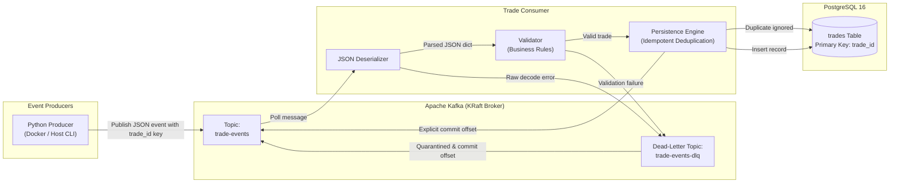

# Trade Event Pipeline (`trade-event-pipeline`)

An event-driven trade processing pipeline built with Python, Apache Kafka (KRaft mode), PostgreSQL, SQLAlchemy 2.0, Docker Compose, pytest, and GitHub Actions CI/CD.

Designed for robust execution on Windows 10/11 using Windows PowerShell and Linux Docker containers.

---

## 1. Architecture Overview



### Event Processing Lifecycle

1. **Trade Producer**: Streams trade events with `trade_id` as the message key to the `trade-events` Kafka topic.
2. **Trade Consumer**: Subscribes with manual offset management (`enable.auto.commit = false`).
3. **Data Validation**:
   - `trade_id`: non-empty string.
   - `symbol`: non-empty string (e.g. `AAPL`, `MSFT`).
   - `quantity`: positive integer (strictly rejects booleans and decimals).
   - `price`: finite positive numeric value (rejects booleans, `NaN`, `+Inf`, `-Inf`, `<= 0`).
   - `side`: must be `BUY` or `SELL`.
   - rejects missing required fields and extra unexpected fields.
4. **Dead-Letter Queue (DLQ)**: Invalid events and malformed JSON are quarantined to `trade-events-dlq` with rejection metadata (timestamp, error type, reason, partition, offset). The offset is then committed so malformed messages do not poison or stall the consumer.
5. **Database Persistence**: Valid events are inserted into the PostgreSQL `trades` table. Duplicate trade IDs are safely ignored without raising fatal errors.
6. **Delivery & Offset Commit**: Kafka offsets are committed **only after** a successful database transaction or successful DLQ quarantine. If an operational database error occurs, the offset is not committed, ensuring at-least-once delivery guarantees.

---

## 2. Technology Stack

- **Language**: Python 3.12 / 3.13
- **Message Broker**: Apache Kafka 3.9.1 (KRaft mode, no ZooKeeper dependency)
- **Database**: PostgreSQL 16 (Alpine)
- **ORM / Driver**: SQLAlchemy 2.0 + Psycopg 3 (`psycopg[binary]`)
- **Containerization**: Docker Desktop & Docker Compose v2
- **Testing**: pytest & unittest
- **CI/CD**: GitHub Actions

---

## 3. Project Structure

```
trade-event-pipeline/
├── .github/
│   └── workflows/
│       └── ci.yml             # GitHub Actions CI workflow (Test + Docker Build)
├── app/
│   ├── __init__.py            # Application package initializer
│   ├── database.py            # PostgreSQL models, connection engine & persistence
│   ├── validator.py           # Trade schema and business rule validator
│   ├── producer.py            # Kafka trade publisher with delivery reports
│   └── consumer.py            # Kafka consumer, DLQ producer & offset management
├── tests/
│   ├── __init__.py
│   ├── test_validator.py      # Unit tests for trade validation rules
│   └── test_database.py       # In-memory SQLite tests for deduplication & rollback
├── .env.example               # Environment variables template
├── .gitignore                 # Git ignore rules for Python, Docker, and secrets
├── Dockerfile                 # Multi-stage/lean Python 3.12 container definition
├── docker-compose.yml         # Multi-container orchestration (Kafka, Postgres, Consumer, Producer)
├── requirements.txt           # Pinned production and test dependencies
└── README.md                  # Comprehensive documentation
```

---

## 4. Prerequisites

1. **Windows 10 / 11** with **Windows PowerShell**.
2. **Docker Desktop for Windows** (Ensure Docker Desktop is running with WSL 2 backend).
3. **Python 3.11+** installed locally (if running scripts outside Docker).

---

## 5. Local Setup (Windows PowerShell)

Open PowerShell and navigate to the project directory:

```powershell
cd c:\Users\kripa\Desktop\kafka\trade-event-pipeline
```

### 1. Create and Activate Virtual Environment

```powershell
py -m venv .venv
.\.venv\Scripts\Activate.ps1
```

> *Tip: If PowerShell blocks script execution, run `Set-ExecutionPolicy -Scope Process -ExecutionPolicy Bypass`.*

### 2. Configure Environment Variables

Copy the example environment file:

```powershell
Copy-Item .env.example .env
```

Review `.env` settings:
- Host access uses `localhost:29092` for Kafka and `localhost:5432` for PostgreSQL.
- Docker internal containers use `kafka:9092` and `postgres:5432`.

### 3. Install Dependencies

```powershell
python -m pip install --upgrade pip
python -m pip install -r requirements.txt
```

---

## 6. Running with Docker Compose

Ensure Docker Desktop is started.

### 1. Start Kafka, PostgreSQL, and Consumer

Build and run services in detached mode:

```powershell
docker compose up -d --build
```

### 2. Verify Service Status and Healthchecks

```powershell
docker compose ps
```

Expected output:
- `kafka`: `Up (healthy)`
- `postgres`: `Up (healthy)`
- `trade-consumer`: `Up`

### 3. Tail Consumer Logs

```powershell
docker compose logs -f consumer
```

---

## 7. Publishing Trade Events

### Option A: Run the Producer via Docker (Recommended)

Run the one-off producer container using Docker Compose:

```powershell
docker compose run --rm producer
```

This publishes:
- **3 Valid trades**: `TRD-1001` (AAPL), `TRD-1002` (MSFT), `TRD-1003` (GOOGL).
- **1 Duplicate trade**: `TRD-1001` (AAPL) to test deduplication.
- **4 Invalid trades**: `TRD-INV-001` (negative qty), `TRD-INV-002` (negative price), `TRD-INV-003` (invalid side), `TRD-INV-004` (empty symbol).
- **1 Malformed payload**: Non-JSON raw string.

### Option B: Run Producer on Windows Host

Ensure Docker containers are running (with port `29092` exposed):

```powershell
.\.venv\Scripts\Activate.ps1
python -m app.producer
```

---

## 8. Verifying Results

### 1. Inspect PostgreSQL Records

Execute `psql` inside the PostgreSQL container:

```powershell
docker compose exec postgres psql -U trader -d tradesdb -c "SELECT trade_id, symbol, quantity, price, side, created_at FROM trades ORDER BY created_at ASC;"
```

Expected result:
```
 trade_id | symbol | quantity |    price    | side |          created_at          
----------+--------+----------+-------------+------+------------------------------
 TRD-1001 | AAPL   |      100 |  182.500000 | BUY  | 2026-10-27 16:45:00.123456+00
 TRD-1002 | MSFT   |       50 |  420.250000 | SELL | 2026-10-27 16:45:00.234567+00
 TRD-1003 | GOOGL  |       25 |  175.800000 | BUY  | 2026-10-27 16:45:00.345678+00
(3 rows)
```

Notice:
- `TRD-1001` only appears once (duplicate was safely deduplicated).
- Invalid trades were rejected and did NOT enter PostgreSQL.

### 2. Inspect Rejected Events in the Dead-Letter Queue (DLQ)

Read the messages quarantined in the `trade-events-dlq` topic:

```powershell
docker compose exec kafka /opt/kafka/bin/kafka-console-consumer.sh --bootstrap-server localhost:9092 --topic trade-events-dlq --from-beginning --timeout-ms 5000
```

Each quarantined entry includes:
- `key`: Original message key.
- `raw_payload`: Raw event content.
- `rejection_reason`: Explanation of failure (e.g. `quantity must be positive`, `Malformed JSON`).
- `rejected_at`: UTC timestamp.

### 3. Check Consumer Logs

```powershell
docker compose logs --tail 50 consumer
```

You will see:
- `SUCCESS: Persisted trade 'TRD-1001'`
- `SUCCESS: Persisted trade 'TRD-1002'`
- `SUCCESS: Persisted trade 'TRD-1003'`
- `DUPLICATE: Trade 'TRD-1001' was already recorded. Skipped safely.`
- `Routing rejected event to DLQ topic 'trade-events-dlq'` for invalid events.

---

## 9. Running Tests

### Unit Tests (No Kafka or PostgreSQL required)

Run with pytest:

```powershell
python -m pytest -v
```

Or run with standard library unittest:

```powershell
python -m unittest discover -v tests
```

---

## 10. Stopping the Services

To stop containers while keeping data volume:

```powershell
docker compose down
```

To stop containers and wipe PostgreSQL volume:

```powershell
docker compose down -v
```

---

## 11. GitHub Actions CI/CD

The workflow in `.github/workflows/ci.yml`:
1. Triggers on every push to `main` and pull requests targeting `main`.
2. Sets up Python 3.12 and installs dependencies from `requirements.txt`.
3. Executes unit tests (`python -m pytest -v`).
4. Builds the Docker container image to verify image build integrity.
5. Fails if either tests or container build fail.

### How to Push to GitHub

```powershell
git init
git add .
git commit -m "feat: complete trade event pipeline with DLQ, validation, and Docker Compose"
git branch -M main
git remote add origin https://github.com/<your-username>/<your-repo>.git
git push -u origin main
```

---

## 12. Failure Handling & Architecture Guarantees

| Scenario | Behavior | Guarantee |
| :--- | :--- | :--- |
| **Malformed JSON** | Decoded error caught -> quarantined to `trade-events-dlq` -> offset committed. | Pipeline does not block; bad data preserved. |
| **Business Rule Violation** | `validate_trade` raises `ValueError` -> sent to DLQ -> offset committed. | Data integrity maintained; non-compliant records quarantined. |
| **Duplicate `trade_id`** | Detected via primary key query / DB check constraint -> logged and safely ignored -> offset committed. | Exactly-once business effect (idempotency). |
| **PostgreSQL Downtime** | `OperationalError` caught -> transaction rolled back -> offset **NOT** committed -> exponential/linear backoff. | At-least-once delivery; zero data loss during outages. |
| **Consumer Termination** | `SIGINT`/`SIGTERM` caught -> current message finishes -> DLQ flushed -> `consumer.close()` cleans up partitions. | Clean shutdown without partition rebalance churn. |

---

## 13. Troubleshooting

- **Docker Desktop not running**: Start Docker Desktop from the Start menu or run `Start-Process "C:\Program Files\Docker\Docker\Docker Desktop.exe"` and wait until the engine icon in taskbar turns green.
- **Port Conflict on 5432**: If local PostgreSQL is running on Windows, stop it with `Stop-Service postgresql*` or modify `POSTGRES_PORT` in `.env` and `docker-compose.yml`.
- **Kafka connection refused on host**: Ensure port `29092` is forwarded and container is healthy (`docker compose ps`).

